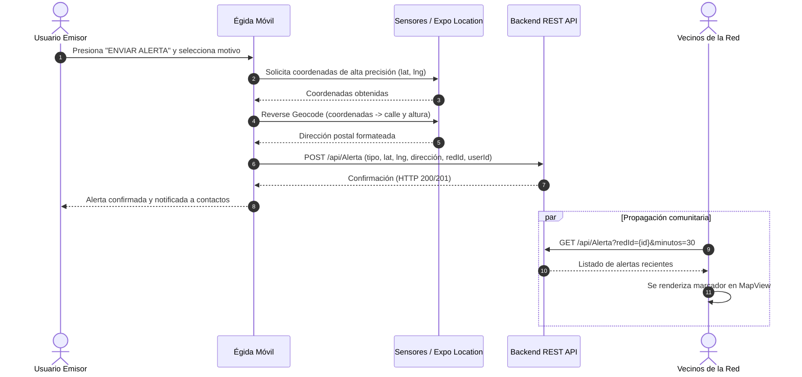
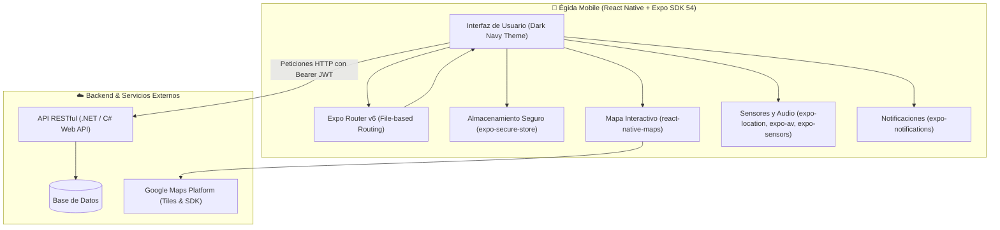

# 🛡️ Égida — Aplicación Móvil de Seguridad Comunitaria


**Égida** es una aplicación móvil colaborativa diseñada para fortalecer la seguridad vecinal y ciudadana mediante redes de apoyo comunitario. Permite a los vecinos conectarse dentro de su comunidad para reportar incidentes en tiempo real, visualizar alertas georreferenciadas en un mapa interactivo, comunicarse por canales de chat grupales e individuales, gestionar contactos de emergencia y disparar alarmas rápidas ante situaciones de riesgo.

---

## 📋 Tabla de Contenidos

1. [¿Cómo Funciona Égida?](#-cómo-funciona-égida)
2. [Arquitectura del Sistema](#-arquitectura-del-sistema)
3. [Módulos y Funcionalidades](#-módulos-y-funcionalidades)
4. [Estructura del Proyecto](#-estructura-del-proyecto)
5. [Requisitos Previos](#-requisitos-previos)
6. [Instalación y Puesta en Marcha](#-instalación-y-puesta-en-marcha)
7. [Configuración de Conexión (Backend y Mapas)](#-configuración-de-conexión-backend-y-mapas)
8. [Scripts Disponibles](#-scripts-disponibles)
9. [Compilación y Construcción (EAS Build)](#-compilación-y-construcción-eas-build)
10. [Contrato de Integración con el Backend (API REST)](#-contrato-de-integración-con-el-backend-api-rest)

---

## 🔍 ¿Cómo Funciona Égida?

El ecosistema de **Égida** se apoya en tres pilares fundamentales: **Comunidad**, **Geolocalización** y **Respuesta Inmediata**:

```
 ┌────────────────┐       ┌─────────────────┐       ┌─────────────────┐
 │   1. REGISTRO   │ ───>  │  2. RED VECINAL │ ───>  │ 3. ALERTA Y MAPA│
 │  Validación de │       │  Pertenencia a  │       │ Geolocalización │
 │  cuenta y edad │       │ redes barriales │       │    en vivo      │
 └────────────────┘       └─────────────────┘       └─────────────────┘
                                                             │
                                  ┌──────────────────────────┴───────────────┐
                                  ▼                                          ▼
                      ┌──────────────────────┐                   ┌──────────────────────┐
                      │ 4. CHAT Y COMUNIDAD  │                   │ 5. CONTACTOS Y SOS   │
                      │  Mensajería vecinal  │                   │ Notificación directa │
                      │   grupal y privada   │                   │  y gestos de pánico  │
                      └──────────────────────┘                   └──────────────────────┘
```

1. **Afiliación por Redes Seguras**: Cada usuario se une a una o más redes territoriales (barrio, edificio, zona) mediante un código de invitación alfanumérico.
2. **Geolocalización y Emisión de Alertas**: Cuando un vecino percibe o sufre un delito (robo, disparos, actividad sospechosa, etc.), puede emitir una alerta con un solo toque o mediante gestos rápidos de hardware.
3. **Geocodificación Automática**: La aplicación obtiene las coordenadas GPS precisas del dispositivo y las convierte automáticamente en una dirección física (calle, número y localidad).
4. **Visualización en Tiempo Real**: En la pantalla principal, los vecinos de la red activa observan un mapa con estilo nocturno que despliega marcadores interactivos con los incidentes ocurridos en los últimos 30 minutos.
5. **Comunicación y Ayuda**: Los miembros pueden ver los detalles del hecho, contactar al afectado (si sus opciones de privacidad lo permiten), coordinar asistencia mediante el chat comunitario de la red o por mensajería privada directa.

---

## 🏗️ Arquitectura del Sistema

La solución está construida sobre **React Native** con el entorno de trabajo **Expo**, utilizando la **Nueva Arquitectura de React Native (Fabric & TurboModules)** y **Expo Router** para la navegación basada en el sistema de archivos.

### Diagrama de Flujo: Emisión y Consulta de Alertas



### Diagrama de Tecnologías y Servicios



---

## ✨ Módulos y Funcionalidades

### 1. 🔐 Autenticación y Verificación de Cuentas

- **Registro Seguro**: Solicita datos personales (nombre, apellido, DNI, teléfono, alias, ocupación) y la clave de la red a la que se desea pertenecer.
- **Validación de Mayoría de Edad**: Comprobación estricta de edad mínima de 13 años mediante selector de fecha de nacimiento (`@react-native-community/datetimepicker`).
- **Verificación de Email en Dos Pasos**: Envío y validación de código numérico de 5 dígitos antes de permitir el ingreso.
- **Inicio de Sesión y Persistencia**: Guarda el token JWT de forma cifrada mediante `expo-secure-store`.
- **Recuperación de Contraseña**: Flujo completo de solicitud de código por correo, verificación y restablecimiento de contraseña.

### 2. 🗺️ Mapa de Seguridad en Vivo (Home)

- Visualización de mapa en modo oscuro (`customMapStyle`).
- Marcadores de alertas activas emitidas en los últimos 30 minutos dentro de la red activa del usuario.
- Tarjeta modal flotante (`AlertaDetalleCard`) que expone: motivo del incidente, nombre o alias del usuario emisor, dirección física y hora local.
- Acceso rápido para conmutar de red y botón flotante de emisión de emergencia.

### 3. 🚨 Emisión de Alertas de Emergencia

- Catálogo de motivos predefinidos:
  - 🔴 _Robo_
  - 🚗 _Secuestro de vehículo_
  - 🏠 _Allanamiento_
  - ⚠️ _Secuestro_
  - 👁️ _Actividad sospechosa_
  - 💥 _Disparos de arma de fuego_
- Geolocalización satelital inmediata y geocodificación inversa para enviar la calle y número exacto.
- Registro con estado inicial _"En proceso"_.

### 4. 🌐 Gestión de Redes Comunitarias

- **Mis Redes**: Visualización de todas las redes a las que pertenece el vecino y cambio instantáneo de red activa.
- **Unirse a Red**: Incorporación a nuevas comunidades vecinales introduciendo el código alfanumérico único proporcionado por administradores barriales.
- Selección automática de red al iniciar sesión si el usuario ya forma parte de una.

### 5. 💬 Mensajería y Red Social de Vecinos

- **Chat de la Red**: Sala de conversación comunitaria general para coordinar temas de seguridad con todos los miembros de la red activa.
- **Comunidad**: Directorio de vecinos de la red con buscador en tiempo real por nombre, apellido o alias.
- **Chat Privado**: Mensajería directa uno a uno entre vecinos con actualización periódica e insignias de mensajes no leídos.
- **Perfil de Vecino**: Vista de datos de contacto de otros miembros (sujeto a las preferencias de privacidad de cada uno).

### 6. 📜 Historial y Gestión de Incidentes

- Registro histórico cronológico de todas las alertas acontecidas en la red.
- Pantalla de detalle individual con estado del evento.
- Opción de eliminar alertas propias una vez subsanada la situación.

### 7. 📳 Gestos Rápidos y Hardware

- Configuración para activar modo de alerta de emergencia al presionar consecutivamente el botón físico de encendido/apagado.
- Confirmación rápida con tipo de alerta predeterminado para situaciones de coacción o peligro inminente.

### 8. 🔔 Sirenas, Sonidos y Notificaciones

- Reproducción de tonos de alarma mediante `expo-av` con librería de sonidos integrada (`assets/sonidos/`):
  - _Alarma de Android_
  - _Sirena de Emergencia_
  - _Sonidos alternativos 3 al 6_
- Control granular de vibración y filtros para silenciar tipos específicos de incidentes según la preferencia del usuario.

### 9. 🛡️ Privacidad y Control de Identidad

Configuración de seguridad personal que permite activar o desactivar:

- **Mostrar nombre**: Al desactivarlo, los demás miembros solo ven el _alias_ del usuario.
- **Compartir ubicación**: Permite ocultar la posición geográfica precisa en el mapa si así se desea.
- **Mostrar contacto**: Oculta el número telefónico para evitar llamadas de terceros fuera de una emergencia.

### 10. 🆘 Contactos de Emergencia

- Registro de contactos clave a quienes se les notifica de forma prioritaria cuando el usuario dispara una alerta.

---

## 📁 Estructura del Proyecto

```
egida_app_fabio/
├── assets/                       # Recursos estáticos de la aplicación
│   ├── images/                   # Logotipos, iconos adaptativos y splash screens
│   └── sonidos/                  # Archivos de audio para sirenas y alarmas (.mp3)
├── src/
│   ├── app/                      # Pantallas y rutas de la aplicación (Expo Router)
│   │   ├── (tabs)/               # Estructura de pestañas inferiores (opcional/base)
│   │   │   └── _layout.tsx
│   │   ├── _layout.tsx           # Layout raíz de Stack y registro de pantallas
│   │   ├── index.tsx             # Pantalla de arranque: verificación de token y redirección
│   │   ├── login.tsx             # Inicio de sesión
│   │   ├── register.tsx          # Registro de nuevos usuarios con clave de red
│   │   ├── verify-email.tsx      # Verificación de código de 5 dígitos enviado por email
│   │   ├── solicitar_recuperacion.tsx # Solicitud de código para restablecer clave
│   │   ├── autenticar_codigo.tsx # Comprobación de código de recuperación
│   │   ├── recuperar_contrasenia.tsx  # Ingreso de nueva contraseña
│   │   ├── home.tsx              # Pantalla principal con MapView oscuro y alertas en vivo
│   │   ├── alerta.tsx            # Formulario para emitir nueva alerta con ubicación GPS
│   │   ├── alertaopc.tsx         # Menú de configuración de alertas (gestos, sonidos, etc.)
│   │   ├── detalle_alerta.tsx    # Vista detallada de un incidente seleccionado
│   │   ├── historial_alertas.tsx # Listado histórico de alertas de la red
│   │   ├── red.tsx               # Administración y cambio de red activa ("Mis Redes")
│   │   ├── unirse_red.tsx        # Formulario para unirse a una red mediante código
│   │   ├── comunidad.tsx         # Directorio de vecinos y búsqueda de miembros
│   │   ├── perfil_usuario.tsx    # Ficha pública de un vecino de la red
│   │   ├── chat.tsx              # Sala de chat privado 1 a 1 entre vecinos
│   │   ├── chat_red.tsx          # Sala de chat comunitario de la red activa
│   │   ├── gestos.tsx            # Configuración de disparador por botón físico
│   │   ├── config-notificaciones.tsx # Preferencias de notificaciones push y filtros
│   │   ├── config-sonidos.tsx    # Selección de tono de sirena y prueba de audio
│   │   ├── emergencias.tsx       # Gestión de contactos de emergencia
│   │   ├── contacto.tsx          # Formulario para añadir contactos de auxilio
│   │   ├── privacidad.tsx        # Ajustes de privacidad (alias vs nombre, GPS, contacto)
│   │   ├── perfil.tsx            # Perfil propio del usuario conectado
│   │   ├── editar_perfil.tsx     # Edición de datos personales del perfil
│   │   └── opciones.tsx          # Menú lateral / central de navegación y cierre de sesión
│   ├── components/               # Componentes reutilizables de UI
│   │   ├── alerta-detalle-card.tsx # Tarjeta flotante con detalles de alerta en el mapa
│   │   ├── ui/                   # Componentes atómicos (iconos vectoriales, colapsables)
│   │   └── themed-text.tsx / themed-view.tsx
│   ├── constants/                # Constantes globales
│   │   ├── imagePath.ts          # Enlaces a imágenes estáticas
│   │   ├── theme.ts              # Paleta de colores e identidades tipográficas
│   │   └── urlApi.ts             # Dirección base de la API REST para dev y prod
│   ├── hooks/                    # Custom Hooks de React (color scheme, temas)
│   ├── services/                 # Clientes HTTP e integración con servicios
│   │   └── api.ts                # Instancia base de Axios
│   └── utils/                    # Utilidades auxiliares
│       └── geocoding.ts          # Funciones de geocodificación inversa con Expo Location
├── app.json                      # Configuración de Expo (permisos, plugins, Google Maps)
├── eas.json                      # Configuración de compilaciones con Expo Application Services
├── eslint.config.js              # Reglas de linting (Expo + Prettier)
├── package.json                  # Dependencias y scripts del proyecto
└── tsconfig.json                 # Configuración del compilador TypeScript
```

---

## 💻 Requisitos Previos

Asegúrate de contar con las siguientes herramientas en tu entorno de desarrollo:

- **Node.js**: Versión `20.x` o superior (LTS recomendada).
- **npm** (versión 10+), **pnpm** o **yarn**.
- **Expo Go** instalado en un dispositivo móvil físico (Android / iOS) o bien un emulador:
  - **Android Studio** con emulador configurado y SDK Android.
  - **Xcode** (únicamente en macOS) con simulador iOS.
- **Git** para el control de versiones.

---

## 🚀 Instalación y Puesta en Marcha

1. **Clonar el repositorio**:

   ```bash
   git clone https://github.com/FabioIgnacioNavarro/egida_app_fabio.git
   cd egida_app_fabio
   ```

2. **Instalar dependencias**:

   ```bash
   npm install
   ```

3. **Configurar la dirección del Backend**:
   Abre el archivo [`src/constants/urlApi.ts`](src/constants/urlApi.ts) y coloca la dirección IP de tu máquina de desarrollo o servidor (ver la siguiente sección).

4. **Iniciar el servidor de desarrollo (Metro Bundler)**:

   ```bash
   npm start
   ```

5. **Abrir la app en tu dispositivo o emulador**:
   - Presiona `a` en la terminal para abrir en un emulador Android.
   - Presiona `i` en la terminal para abrir en el simulador de iOS.
   - Presiona `w` para probar en la versión web.
   - Escanea el código QR desde la app **Expo Go** en tu dispositivo físico Android (o con la app de Cámara en iOS).

---

## ⚙️ Configuración de Conexión (Backend y Mapas)

### 1. Conexión con el Backend REST (`src/constants/urlApi.ts`)

La aplicación detecta automáticamente si se encuentra en modo desarrollo (`__DEV__`). Modifica los valores con la IP de tu red local donde esté corriendo la API:

```typescript
// src/constants/urlApi.ts
const LOCAL_IP = "192.168.1.100"; // Tu IP local en la red Wi-Fi
const PORT = 5285; // Puerto en el que escucha tu servidor backend

export const API_URL = __DEV__
  ? `http://${LOCAL_IP}:${PORT}/api`
  : "https://api.tu-dominio-produccion.com/api";
```

> [!TIP]
> Si pruebas desde un dispositivo móvil físico con **Expo Go**, asegúrate de que tanto el teléfono como la computadora estén conectados a la **misma red Wi-Fi** y que el puerto de la API no esté bloqueado por el firewall de tu sistema operativo.

### 2. Clave de Google Maps (`app.json`)

Para que el mapa renderice correctamente en compilaciones de producción de Android e iOS, debes configurar tu API Key de Google Maps en [`app.json`](app.json):

```json
{
  "expo": {
    "ios": {
      "config": {
        "googleMapsApiKey": "TU_API_KEY_DE_GOOGLE_MAPS_IOS"
      }
    },
    "android": {
      "config": {
        "googleMaps": {
          "apiKey": "TU_API_KEY_DE_GOOGLE_MAPS_ANDROID"
        }
      }
    }
  }
}
```

---

## 📜 Scripts Disponibles

En el archivo [`package.json`](package.json) se definen los siguientes comandos:

| Comando                 | Descripción                                                                          |
| ----------------------- | ------------------------------------------------------------------------------------ |
| `npm start`             | Inicia el entorno de desarrollo con Expo y levanta Metro Bundler                     |
| `npm run android`       | Ejecuta la aplicación de forma nativa en Android (prebuild/run)                      |
| `npm run ios`           | Ejecuta la aplicación de forma nativa en iOS (requiere macOS)                        |
| `npm run web`           | Inicia la versión web interactiva en el navegador                                    |
| `npm run lint`          | Ejecuta ESLint para analizar errores sintácticos y de formateo                       |
| `npm run reset-project` | _(Mantenimiento Expo)_ Script para reiniciar la estructura de rutas a un estado base |

---

## 📦 Compilación y Construcción (EAS Build)

El repositorio incluye soporte para **EAS (Expo Application Services)** configurado en [`eas.json`](eas.json):

1. **Instalar la CLI de EAS**:

   ```bash
   npm install -g eas-cli
   ```

2. **Iniciar sesión en Expo**:

   ```bash
   eas login
   ```

3. **Generar un APK de prueba para Android**:

   ```bash
   eas build --platform android --profile preview
   ```

4. **Generar build de producción (Android AAB / iOS IPA)**:
   ```bash
   eas build --platform all --profile production
   ```

---

## 🌐 Contrato de Integración con el Backend (API REST)

La aplicación móvil consume los siguientes servicios HTTP mediante el estándar de autenticación **Bearer JWT**:

| Controlador       | Método                | Endpoint                                     | Descripción                                    |
| ----------------- | --------------------- | -------------------------------------------- | ---------------------------------------------- |
| **Auth**          | `POST`                | `/api/Auth/login`                            | Inicio de sesión, retorna JWT token            |
| **Auth**          | `POST`                | `/api/Auth/register`                         | Registro de usuario con clave de red y edad    |
| **Auth**          | `POST`                | `/api/Auth/verificar-email`                  | Verificación de correo con código de 5 dígitos |
| **Auth**          | `POST`                | `/api/Auth/solicitar-recuperacion`           | Solicita envío de código para recuperar clave  |
| **Auth**          | `POST`                | `/api/Auth/autenticar-codigo`                | Valida código de recuperación                  |
| **Auth**          | `POST`                | `/api/Auth/restablecer-contrasena`           | Asigna nueva contraseña                        |
| **Alerta**        | `GET`                 | `/api/Alerta?redId={id}&minutos=30`          | Obtiene alertas recientes de la red            |
| **Alerta**        | `GET`                 | `/api/Alerta/{id}`                           | Obtiene los detalles de una alerta específica  |
| **Alerta**        | `POST`                | `/api/Alerta`                                | Publica una nueva alerta con geolocalización   |
| **Alerta**        | `DELETE`              | `/api/Alerta/{id}`                           | Da de baja una alerta emitida                  |
| **Red**           | `GET`                 | `/api/Red/mis-redes`                         | Lista las redes a las que pertenece el usuario |
| **Red**           | `GET`                 | `/api/Red/{id}`                              | Obtiene información de una red en particular   |
| **Red**           | `POST`                | `/api/Red/unirse`                            | Incorpora al usuario a una red mediante código |
| **Usuario**       | `GET`                 | `/api/Usuario/{id}`                          | Información pública de un usuario              |
| **Usuario**       | `GET`                 | `/api/Usuario/usuarios-por-red`              | Listado de miembros de la red activa           |
| **Perfil**        | `GET`                 | `/api/Perfil/mi-perfil`                      | Datos del perfil del usuario en sesión         |
| **Perfil**        | `PUT`                 | `/api/Perfil/actualizar`                     | Actualización de datos personales y alias      |
| **Mensajes**      | `GET`/`POST`          | `/api/Mensaje/privados` / `/api/Mensaje/red` | Envío y recepción de mensajes de chat          |
| **No Leídos**     | `GET`                 | `/api/MensajeNoLeido/...`                    | Conteo de mensajes pendientes y marcar leídos  |
| **Emergencias**   | `GET`/`POST`/`DELETE` | `/api/ContactoEmergencia`                    | ABM de contactos de emergencia                 |
| **Configuracion** | `GET`/`PUT`           | `/api/Configuracion/...`                     | Gestos, privacidad, notificaciones y sonidos   |

---

## 👥 Contribución y Buenas Prácticas

1. Crea una rama descriptiva para tu funcionalidad o corrección (`git checkout -b feature/nueva-funcionalidad`).
2. Mantén la coherencia con el sistema de temas (dark navy `#0F172A` / `#10172B` y acentos de alerta `#FF4444`).
3. Ejecuta `npm run lint` antes de realizar commits para mantener el estándar de código.
4. Realiza tus commits con mensajes claros en español o inglés siguiendo las convenciones convencionales (`feat:`, `fix:`, `docs:`, etc.).
5. Abre un Pull Request describiendo los cambios efectuados.

---

Desarrollado como iniciativa de seguridad colaborativa y comunitaria con **Égida**. 🛡️
